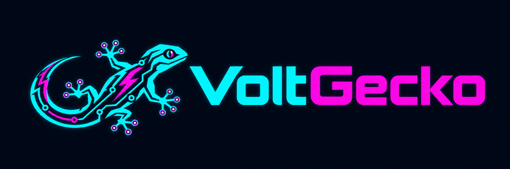

# VoltGecko



Offline-first electrical floor-plan and distribution-board planner, in **English and Hungarian**. Built with React, TypeScript, Vite and an installable PWA; projects stay on the user's device unless the user exports a file or explicitly saves to Google Drive.

[Magyar útmutató](#magyar) · [GitHub](https://github.com/SmartLizardOrg/VoltGecko) · [MIT License](LICENSE)

**Live app / Élő alkalmazás:** [voltgecko.pages.dev](https://voltgecko.pages.dev)

## English

### Features

- Start with a blank project, open a project file or a local project, or explicitly choose the sample. Starting and reloading never creates or opens a sample automatically.
- Choose light or dark appearance and standard or large text. The interface uses larger controls and high-contrast colors; your appearance settings stay on the device.
- Import PDF pages, PNG and JPG floor plans; use multiple sheets, layers, scale calibration, zoom, device placement and rotation.
- Share device identities and properties across floor plans, circuits, distribution boards and single-line diagrams. Record room, mounting height, product details, notes and site photos.
- Draw circuit and control connections, edit routes, arrange DIN devices by row and module width, and see collisions and overcapacity.
- Search the bundled Schneider catalogue offline: 260 references from the Hungarian Easy9 Pro catalogue, including DIN devices, enclosures and accessories. Each entry retains its manufacturer source.
- Export customer and detailed PDF documents, including legends, circuit lists and board layouts. Export the single-line drawing as SVG.
- Save automatically to IndexedDB, save named versions, restore without overwriting history, and transfer a complete project as one `.vgecko` archive with photos and attachments. Legacy `.eplan` backups can still be opened.
- Optionally open or save a snapshot to Google Drive. No account is needed for local use.

### Development

Use **Node.js 22.13+ in the 22 release line**, or **Node.js 24 LTS**. `.node-version` selects the latest Node 22 release for Cloudflare Pages and CI. Node 24 also works locally.

```sh
npm ci
npm run dev
```

Open [localhost:5173](http://localhost:5173). The development server is available on the local network. A phone needs trusted HTTPS for PWA installation and secure browser APIs; see [local HTTPS](#local-https--helyi-https).

### Offline production preview

```sh
npm run build
npm run preview
```

Open [localhost:4173](http://localhost:4173) and wait for **Ready for offline use**. The production build contains the service worker and local PDF resources. After the first successful load, the app can reopen offline with its saved photos and projects. Updates are applied through the app's update prompt.

Browser storage is tied to the exact origin: localhost, a LAN address, a production domain and preview deployment URLs each have separate data. Export a project file to move work between them. Keep external `.vgecko` backups; clearing browser storage or losing the device can remove the local copy. Project files are ZIP archives and are not encrypted.

### Cloudflare Pages with Git integration

The app is a static site: no application server, database, Pages Functions or runtime secrets are required.

1. In Cloudflare **Workers & Pages → Create application → Pages**, import the GitHub repository **SmartLizardOrg/VoltGecko**. Grant the Cloudflare GitHub app access to this repository when requested.
2. Configure the build:

   | Setting | Value |
   | --- | --- |
   | Production branch | `main` |
   | Framework preset | React (Vite), or None with the settings below |
   | Root directory | Repository root |
   | Build command | `npm run build` |
   | Build output directory | `dist` |
   | Node.js | Read from `.node-version` (`22`) |

3. Save and deploy. Git integration rebuilds the site when commits reach the connected branch; pull requests can receive preview deployments.
4. Load the deployed HTTPS URL and wait for the offline-ready indication before installing the PWA or testing offline use.

No environment variables are needed for the core application. Google Drive configuration is optional; `VITE_` values are public build-time configuration, never a place for client secrets. Preview domains use separate browser storage. Use project export/import when changing domains.

Official references: [Pages Git integration](https://developers.cloudflare.com/pages/get-started/git-integration/), [build configuration](https://developers.cloudflare.com/pages/configuration/build-configuration/), [Node version selection](https://developers.cloudflare.com/pages/configuration/build-image/).

### Checks and contributions

```sh
npm test
npm run build
```

Optional browser checks:

```sh
npx playwright install chromium
npm run test:e2e
```

For WebKit, install `webkit` and set `PLAYWRIGHT_BROWSER=webkit` before running the browser tests. Mobile emulation does not replace installation checks on physical Android and iPhone devices. GitHub Actions runs the unit tests and production build for pushes to `main` and pull requests.

The displayed brand and `.vgecko` filename extension are configured in `src/config.ts`; translations are in `src/locales/en-*.ts`. Existing project identifiers, browser database names and the ZIP contents remain stable. Legacy `.eplan` files remain import-compatible, including through Google Drive; new saves use `.vgecko`.

### Scope

VoltGecko documents devices and circuits. It does not calculate cable sizing, protective-device coordination or compliance, and it does not model terminal-by-terminal wiring. The original drawing-symbol library is documented in [SYMBOLS.md](SYMBOLS.md); it is not IEC-certified. Manufacturer catalogue data does not imply automatic electrical or mechanical compatibility checking.

The application source is MIT licensed. Fonts, PDF resources and other dependencies retain their original licenses; see [third-party notices](THIRD_PARTY_NOTICES.md). The sample project is fictional.

## Magyar

A VoltGecko offline is használható alaprajz- és elosztótervező. A felső **HU / EN** választóval magyar és angol felület között válthatsz; a PDF rendszerfeliratai is a választott nyelven készülnek. A meglévő projektadatokat a nyelvváltás nem írja át.

Induláskor a kezdőképernyőn választhatsz: **Új projekt**, **Projekt megnyitása** vagy **Mintaprojekt kipróbálása**. A helyi projektek külön listából nyithatók meg; automatikusan nem indul sem minta, sem korábban mentett terv. A **Téma** és **Betűméret** beállítás a kezdőképernyőn, munka közben az oldalsó eszköztár alján érhető el. Világos/sötét megjelenés és normál/nagy betű választható; a böngésző megjegyzi őket.

### Indítás és használat

Node.js 22.13+ (22-es ág) vagy Node.js 24 LTS szükséges. Klónozás után `npm ci`, majd `npm run dev`; megnyitás: [localhost:5173](http://localhost:5173). Az offline működéshez `npm run build`, majd `npm run preview`; megnyitás: [localhost:4173](http://localhost:4173). Várd meg az **Offline használatra kész** jelzést.

- A PDF minden oldala külön tervlapként importálható; PNG/JPG vagy üres tervlap is használható. Az eszköz kijelölés után húzással vagy nyílbillentyűkkel mozgatható. A Delete csak a tervlapról veszi le; az adatlap törlés gombja a közös eszközt törli.
- A kapcsolat és vezérlés eszközzel két eszköz összeköthető. A töréspontok húzhatók; dupla kattintás új töréspontot ad. A méretarány két pont és ismert távolság alapján kalibrálható.
- Az elosztóban a sor, kezdőhely és modulszélesség szerkeszthető, félmodulos értékekkel is. A program jelzi az ütközést és túlfoglalást. Az egyvonalas nézet a megadott készülékkapcsolatokból épül fel.
- Az áramkörhöz védelmi készülék, kábelmegnevezés, fogyasztótípus és teljesítmény rögzíthető. Ezek dokumentációs adatok; nem indítanak automatikus villamos méretezést.
- A fotók, megjegyzések és eszközadatok ugyanahhoz az eszközhöz tartoznak minden nézetben. Az ügyfél- és részletes PDF mellett az egyvonalas rajz SVG-ként is menthető.

### Terméktár és import

A beépített terméktár a Schneider Electric **Easy9 Pro Katalógus 2025., 2.0 kiadás (2026. április 2.)** 6–34. oldalának **260 rendelési cikkszámát** tartalmazza: 112 Easy9 Pro DIN-készülék, 1 Acti9 DIN-távtartó, 72 szekrény és 75 tartozék. [Gyártói forrás](https://www.se.com/hu/hu/download/document/Easy9Pro_catalog_HU/). A lista offline kereshető; nem automatikusan frissülő, teljes világpiaci adatbázis. Az Easy9 EU és PrismaSeT XS elemek a saját termékcsaládnevükön szerepelnek.

A DIN-készülék az első szabad helyre kerül, a szekrény új elosztót hoz létre, a sínhelyet nem foglaló tartozék az anyaglistába kerül. A modulszélesség alapja 18 mm. A projektben a kiválasztott termékadatok önálló másolatként megmaradnak; későbbi katalógusfrissítés nem módosítja a kész terveket.

Korábbi önálló HTML-elosztótervező 2-es verziójú JSON-mentése (`{v:2, project, rows, comps, wires, nid}`) a projektmegnyitással importálható. Az import a JSON-adatokat veszi át új projektbe; HTML-t nem futtat. A generikus szélességek ellenőrizendő adatként maradnak meg.

### Mentés és adatkezelés

Az automatikus mentés az adott böngészőprofil IndexedDB-tárába kerül. A **Projektfájl mentése** egy `.vgecko` ZIP-archívumban viszi magával a tervet, előzményeket és mellékleteket. A korábbi `.eplan` fájlok továbbra is megnyithatók, a Google Drive-választóban is. Ez a külső biztonsági mentés és az eszközök közötti átadás alapja. A fájl nincs titkosítva.

A **Verzió mentése**, **Előzmények** és **Visszaállítás** funkciók megőrzik az állapotokat; visszaállításkor a jelenlegi állapot is megmarad. Azonos azonosítójú, eltérő projektimport külön másolatként nyílik meg. Automatikus összefésülés nincs.

A böngészőadatok törlése vagy az eszköz elvesztése a helyi példányt is eltávolíthatja. A localhost, a telefonos LAN-cím, a nyilvános domain és az előnézeti URL külön tárhelyet használ: projektfájllal vihető át a munka. A PDF átadási dokumentum; szerkesztésre a projektfájl szolgál.

### Google Drive

Google-beállítás nélkül az alkalmazás teljesen használható. Saját OAuth-konfigurációhoz másold a `.env.example` fájlt `.env.local` névre; a pontos lépések a [helyi integrációk útmutatójában](src/services/README.md) találhatók. A nyilvános domainhez annak pontos eredetét is engedélyezni kell a Google Cloud projektben.

A Google-könyvtárak csak csatlakozáskor töltődnek be. A hozzáférési token memóriában marad, a kért jogosultság `drive.file`. Minden kézzel indított Drive-mentés új projektpillanatkép; nincs háttérszinkron vagy saját szerveren tárolt projektadat.

### Local HTTPS / Helyi HTTPS

Telefonos helyi teszthez azonos hálózat és megbízható HTTPS szükséges. A telefon saját `localhost` címe a telefont jelenti.

```powershell
# Egyszeri telepítés / install once:
winget install FiloSottile.mkcert
# A PC tényleges LAN IP-címével / use the PC's actual LAN address:
powershell -ExecutionPolicy Bypass -File scripts/setup-local-https.ps1 -LanAddress 192.168.1.10
npm run build
npm run preview:https
```

Nyisd meg a telefonon a `https://<PC-IP>:4173` címet. A mkcert helyi CA-jának `rootCA.pem` tanúsítványát telepíteni és megbízhatóvá tenni kell. iPhone-on a profil telepítése után a tanúsítvány megbízhatóságát külön is engedélyezni kell; Androidon a tanúsítványkezelésben telepíthető. A `rootCA-key.pem` magánkulcsot ne másold át és ne oszd meg. A `.cert/` és `.env.local` helyi, Gitből kizárt fájlok.

iPhone: Safari → Megosztás → Főképernyőhöz adás. Android: Chrome → Telepítés / Főképernyőhöz adás. A nyilvános HTTPS-oldal használatához helyi tanúsítvány nem kell.

### Licenc és szakmai határok

Az alkalmazás forráskódja [MIT licencű](LICENSE). A saját SVG-jelek CC0 felajánlása és szakmai ellenőrzésük állapota a [SYMBOLS.md](SYMBOLS.md) fájlban olvasható. A függőségek és betűk eredeti licence megmarad: [THIRD_PARTY_NOTICES.md](THIRD_PARTY_NOTICES.md).

A program eszköz- és áramkörszintű tervezést, dokumentálást támogat. Vezetékméretezést, védelmi megfelelőségvizsgálatot és kapcsonkénti huzalozást nem számít. A rajzjelek szakmai megfeleltetése még szükséges; a könyvtár nem IEC-tanúsított. A mintaprojekt fiktív.
